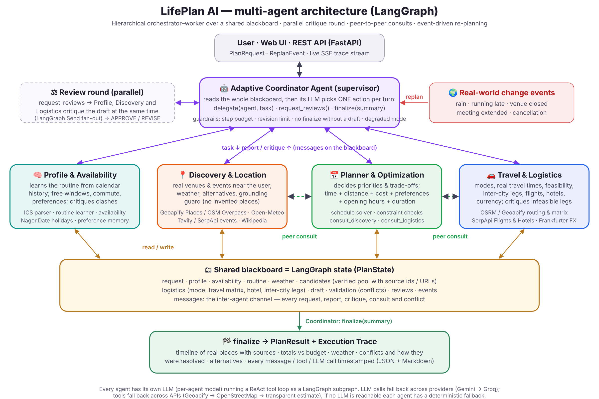
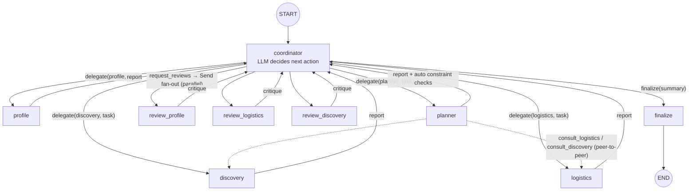
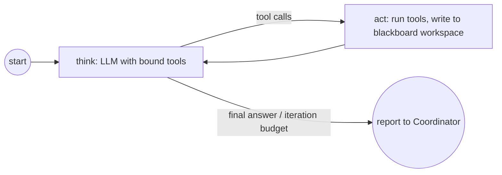

# LifePlan AI — Design Document

Multi-agent AI personal planner for time, activities and travel · CA3 (Agentic AI)

## 1. Architecture overview



LifePlan AI runs **five LLM agents** in one **LangGraph `StateGraph`**. The **Adaptive Coordinator** is the supervisor node. The four specialists are worker nodes, and each one is itself a **ReAct subgraph** with its own model and tools. Agents communicate through a **shared blackboard** (the graph state). The blackboard holds the planning data and an explicit **message channel** (`messages`), plus `reviews` (critiques) and `conflicts`.

The compiled main graph (`lifeplan/graph.py`):



Each specialist's internal loop (`lifeplan/agents/base.py`):



The order of steps is **not fixed**. On every turn the Coordinator's LLM reads the blackboard (availability, candidates, logistics, draft, validation issues, latest critiques, recent messages, replan events) and calls exactly one decision tool. The graph routes on that decision with conditional edges.

## 2. Agents: roles and responsibilities

| | 🤖 Coordinator | 🧠 Profile & Availability | 📍 Discovery & Location | 🚗 Travel & Logistics | 📅 Planner & Optimization |
|---|---|---|---|---|---|
| **Role** | Supervisor and decision-maker. Routes work, resolves conflicts, decides when the plan is good enough, handles re-planning. | Knows the user and **when they are really free**. | Finds **real** things to do and checks the weather. Grounding guard. | Decides **how** the user moves and whether that is **feasible**. | Builds and revises the **actual schedule**. |
| **Decides** | which agent works next and on what; when to request critiques; when to finalise | whether to trust the learned routine (e.g. on a holiday); which free windows are real | which categories, radius and events to search; indoor vs outdoor under rain; replacements | local travel mode; which candidates get a travel matrix; inter-city option; hotel | priorities (0–1) per candidate, must-haves, pace, what to drop to resolve conflicts |
| **Tools** | `delegate`, `request_reviews`, `finalize` | `get_profile`, `learn_routine`, `compute_availability`, `check_holidays`, `remember_preference`, `check_calendar_conflicts` | `search_venues`, `find_events`, `register_event`, `search_web`, `get_weather`, `destination_brief`, `find_alternatives`, `mark_unavailable`, `check_venues` | `choose_travel_mode`, `travel_time_between`, `prepare_travel_matrix`, `intercity_options`, `search_flights`, `search_hotels`, `select_hotel`, `add_intercity_leg`, `convert_currency`, `check_travel_and_budget` | `list_candidates`, `build_schedule`, `validate_plan`, `consult_logistics`, `consult_discovery` |
| **External data** | — | user's .ics (Google/Outlook export), Nager.Date | Geoapify Places, OSM Overpass, Tavily, SerpApi Google Events, Open-Meteo, Wikipedia | OSRM, Geoapify Routing/Matrix, SerpApi Google Flights & Hotels, Frankfurter, REST Countries | deterministic solver + validators |
| **Writes to blackboard** | `next`, `task`, `messages`, `conflicts`, `final_summary` | `routine`, `availability`, `profile` | `candidates`, `weather`, `event_sources` | `logistics` (mode, matrix, hotel, fixed legs, intercity) | `draft`, `validation` |
| **In review rounds** | — | checks calendar / routine / window clashes | checks hours, grounding and rain; proposes open alternatives | checks leg feasibility and budget; may switch mode | — (revises when asked) |
| **Default model** | `gemini-flash-latest` | `gemini-flash-lite-latest` | `gemini-flash-lite-latest` | `gemini-flash-lite-latest` | `gemini-flash-latest` |
| **Without an LLM** | deterministic policy (profile → discovery → logistics → planner → fix → finalise) | compute availability | weather + interest search | default mode + matrix (+ cheapest hotel) | interest/distance priorities |

**Why five agents and not one?** Each agent has a different information source, toolset and failure mode. Their objectives also pull against each other: Discovery wants the best experience, Profile protects the user's commitments, Logistics enforces physical feasibility and budget, and the Planner has to trade these off. Splitting them keeps each prompt small, so it fits free-tier limits and the model reasons better within one domain. It also lets each agent use a different model and makes the conflicts *explicit* messages that a supervisor can arbitrate. A single agent with 30 tools would have to keep all of this in one context and would hide its trade-offs.

## 3. Orchestration pattern

**Hierarchical orchestrator–worker (supervisor) over a blackboard, with a parallel critique round and peer-to-peer consultation.**

* **Supervisor (orchestrator–worker):** the Coordinator is the only node that routes control. Every worker returns to it, which gives one place to resolve conflicts, enforce guardrails and adapt the plan of work.
* **Blackboard:** agents never pass large payloads to each other. They write structured facts to shared state (LangGraph channels with reducers, so parallel reviewers can update `candidates`, `logistics` and `reviews` safely), and they post short natural-language messages for the Coordinator.
* **Critique round:** `request_reviews` fans out with LangGraph `Send` to three reviewers that run **in parallel**. Each critiques the draft from its own domain and returns APPROVE or REVISE with concrete fixes.
* **Peer-to-peer:** the Planner can call Logistics or Discovery directly mid-task (`consult_*`). The consulted agent runs its own ReAct loop, and its blackboard updates become visible to the Planner.
* **Event-driven re-planning:** a `ReplanEvent` mutates the stored blackboard (wet hours, unavailable venue, new busy block) and re-enters the same graph at the Coordinator. The previous candidates, logistics and draft are kept, so the agents adjust rather than start over.

**Why this pattern:** a pure pipeline cannot loop back when a later stage finds a problem, which was the failure mode the CA3 guidelines warn about. Pure peer-to-peer gives no single place to arbitrate a three-way conflict. A supervisor with a blackboard keeps control flow explicit and traceable while still letting agents disagree, critique and talk directly.

### Inter-agent message protocol

Every message is stored on the blackboard and in the trace:

```json
{"from": "profile", "to": "coordinator", "kind": "critique", "content": "REVISE: the 19:00 show overlaps your meeting until 19:30 (+45 min commute) …", "step": 6}
```

`kind` is one of: `request` (Coordinator → agent), `report` (agent → Coordinator), `review_request`, `critique`, `consult` / `consult_reply` (peer-to-peer), `event` (environment → Coordinator). The trace also records `decision`, `conflict`, `tool_call`, `llm_call`, `llm_error`, `guardrail`, `degraded_mode` and `final` events.

### Coordinator control loop and guardrails

1. Build a compact view of the blackboard: free windows, candidate counts by category, logistics, draft outline, validation issues, latest critiques, last 12 messages, replan events and guardrail notes.
2. Call the LLM with three decision tools (`tool_choice="any"`) and parse the decision.
3. Apply hard guardrails (`coordinator.sanitize`):
   - `finalize` or `request_reviews` without a draft is turned into a request to the planner;
   - unknown agent names are rerouted;
   - at most 2 review rounds and `MAX_REVISIONS` planner revisions;
   - the step budget (`MAX_COORDINATOR_STEPS`) forces finalisation.
4. Record newly opened high-severity conflicts together with the instruction the Coordinator issued for them. At the end, conflicts that disappeared are reported as **resolved, with that resolution**.

## 4. Conflict detection and resolution

After every agent turn that touches a draft, the domain checks run (`lifeplan/tools/validator.py`). Each check belongs to the agent whose domain it is:

| Check | Raised by | Severity |
|---|---|---|
| `CALENDAR_CONFLICT`, `OUTSIDE_WINDOW` | Profile | high |
| `PREDICTED_BUSY` (learned routine) | Profile | medium/low depending on confidence |
| `TRAVEL_INFEASIBLE`, `OVERLAP`, `OVER_BUDGET` | Logistics | high |
| `CLOSED`, `UNVERIFIED_PLACE` (anti-hallucination) | Discovery | high |
| `LIKELY_CLOSED` (no published hours, outside the category's typical hours) | Discovery | medium |
| `WEATHER_RISK` (outdoor + rain) | Discovery | medium |
| `HOURS_UNKNOWN`, `NEAR_BUDGET` | Discovery / Logistics | low |

The Coordinator sees the issues and the reviewers' critiques, and it decides the fix and who should do it. It might tell the Planner to drop an event, ask Discovery for an alternative first, or ask Logistics to switch from transit to a cab.

**Worked example (the proposal's three-way conflict; illustrative — real runs are in `samples/traces/`):**

```mermaid
sequenceDiagram
    participant U as User
    participant C as Coordinator
    participant P as Profile
    participant D as Discovery
    participant L as Logistics
    participant PL as Planner
    U->>C: "Meeting at the office till 19:30, then comedy + dinner"
    C->>P: compute free windows
    P-->>C: meeting until 19:30 + 45 min commute → free from 20:15
    C->>D: find comedy/music + dinner, check weather
    D-->>C: comedy show 19:00–20:30 (source URL), 6 restaurants, rain after 20:00
    C->>L: choose mode + travel matrix
    L-->>C: cab; venue is 40 min from the office
    C->>PL: build the plan
    PL-->>C: draft includes the 19:00 show
    Note over C: CALENDAR_CONFLICT (Profile) + TRAVEL_INFEASIBLE (Logistics)
    C->>PL: "Show at 19:00 clashes with meeting till 19:30 and needs 40 min travel — drop it, dinner first, find a later show"
    PL->>D: consult: later comedy show or indoor dessert place after 21:30?
    D-->>PL: 21:30 show at another venue / alternatives
    PL-->>C: revised plan, no high issues
    C->>P: review (parallel with D and L)
    P-->>C: APPROVE
    C-->>U: finalize: plan + "moved the show because of your meeting"
```

## 5. Dynamic re-planning

`POST /api/replan` (or the UI buttons) with `event ∈ {weather, delay, cancellation, closed, schedule_change, user_feedback}`:

* **weather**: hours from the affected item onward are marked wet, so outdoor items now trigger `WEATHER_RISK` and Discovery looks for indoor alternatives.
* **closed / cancellation**: the affected candidate is marked unavailable, so the solver cannot reuse it.
* **delay / schedule_change**: a new busy block is added and availability is reset, so the Coordinator must ask Profile to recompute free time (commute included).
* For a plan already in progress, only the remaining time is re-planned.

The Coordinator is told to change only what the event affects. The trace of a re-plan is a separate run with `kind: "replan"`.

## 6. Grounding (hallucination control)

The review raised the concern that recommended venues and events might not be real. We handle it at three levels:

1. **Venues** come only from Geoapify Places or OpenStreetMap, and each carries a `source` and `source_id` (OSM node/way).
2. **Events** can only be added with `register_event`, which **rejects any URL that was not returned by the live search tool**. Event times must be stated by the source.
3. The **validator rejects any itinerary item whose `candidate_id` is not in the verified pool** (`UNVERIFIED_PLACE`, high severity). The Planner's solver also ignores unknown ids. Every item in the final plan shows its source, and the plan lists all sources.

Costs and some travel times are estimates. They are marked `estimate: true` and shown with "~" in the UI.

## 7. Memory

* **Working memory:** the blackboard (LangGraph state) for one run, including the message history the Coordinator reasons over.
* **Long-term user memory** (`ProfileStore`): home/work, working hours, commute, interests, dislikes, and **learned preference weights**. These are updated from feedback (`POST /api/feedback`) and from `remember_preference`. Learned weights are attached to every candidate (`pref`) that the Planner sees when it sets priorities, and disliked categories are filtered out by Discovery.
* **Learned routine:** `learn_routine` turns calendar history into per-weekday busy blocks with confidence (the fraction of observed weeks in which each 30-minute slot was busy) and frequent locations. Predictions are used only where the real calendar is silent, and explicit input always overrides them.
* **Plan memory** (`PlanStore`): the final blackboard of every plan is kept for re-planning.

## 8. Robustness and failure handling

| Failure | Behaviour |
|---|---|
| Tool/API error | caught inside the agent's `act` node and returned to the LLM as `{"ok": false, "error": …}`; the agent adapts (e.g. widens the radius) |
| Geoapify down / no key | automatic fallback to OSM Nominatim / Overpass / OSRM, then to a labelled estimate |
| LLM rate limit ("try again in 240 ms") | wait the suggested time and retry the same model (up to 20 s) |
| LLM overloaded (503/504) | circuit breaker skips that model for 90 s; the agent's own fallback model on the next provider takes over (light agents fall back to light models, spreading free-tier quota) |
| Provider switch mid tool-loop | Gemini is never asked to continue a tool-calling loop another provider started (it requires its own thought signatures) |
| All models busy | wait 10 s and try the chain once more; `llm_error` / `llm_wait` / `fallback_used` are all logged |
| No LLM reachable at all | per-agent deterministic fallback, plan status `partial`, warning shown |
| Bad input | Pydantic validation → HTTP 422 with readable reasons; unknown place → 422 "Could not find…" |
| Agent loops / indecision | step budget, revision limit, recursion limit, at most two review rounds |
| Parallel writes | LangGraph reducers (`merge_dict`, list append) on shared channels |

## 9. Technology choices and justification

| Choice | Why |
|---|---|
| **LangGraph 1.x** | Explicit graph with cycles, conditional routing and `Send` fan-out, which is exactly the shape of supervisor + revision loops + parallel critique. State reducers make the blackboard safe. Also the industry standard named in the CA3 guidelines. |
| **LangChain chat models** (`langchain-google-genai`, `langchain-groq`, `langchain-openai`) | One tool-calling interface for every provider, so **each agent can use a different model** and calls can fall back across providers. |
| **Per-agent models** | Coordinator and Planner do multi-constraint reasoning, so they get `gemini-flash`. Profile, Discovery and Logistics mostly call tools and summarise, so they get the faster and cheaper `flash-lite`. This keeps runs within free-tier RPM limits. Groq `gpt-oss-120b/20b` is the fallback. |
| **Deterministic solver + validators as tools** | LLMs are poor at exact time arithmetic. The LLM decides *what matters*, and the solver does the combinatorial fitting (time windows, opening hours, travel matrix, budget, rain) reliably and testably. |
| **Real APIs with free tiers** | Geoapify / OSM (places, routing), Open-Meteo (weather), Tavily / SerpApi (live events, flights, hotels), Frankfurter (FX), Nager.Date (holidays). A keyless fallback exists for each core need. |
| **FastAPI + Server-Sent Events** | Typed I/O schemas (auto `/docs`), and the trace streams to the browser so evaluators *see* agents talking live. |
| **Vanilla JS + Leaflet UI** | No build step, so it deploys with the API as one service. |
| **Render (free) / Docker** | One-click blueprint deploy from GitHub, auto-deploy on push. |

## 10. Testing and evaluation

* **41 automated tests** (`pytest`, offline). They use scripted tool-calling LLMs and a fake HTTP layer with realistic API payloads, run in CI on Python 3.10 and 3.12, and run the **entire graph** end to end:
  - a full run produces a grounded plan that respects availability, and every agent communicates;
  - the three-way conflict is detected and resolved through a planner revision;
  - LLM outage leads to degraded mode;
  - a failing primary model falls back to another provider;
  - Geoapify failure falls back to OpenStreetMap;
  - re-planning after a meeting extension respects the new commute;
  - API validation, streaming and feedback learning work.
* **Unit tests:** opening-hours parser, RRULE calendar expansion, routine learning, availability merge, scheduler (windows, hours, budget, must-include, fixed-time events, rain avoidance), validators.
* **Live runs:** `scripts/run_demo.py` and the *Live agent run* GitHub workflow execute the real agents and save the execution trace (`samples/traces/`).
* **Run metrics in every result:** LLM calls, tool calls, messages, tokens, fallbacks, tool errors, coordinator steps, planner revisions and review rounds.

## 11. Responsible AI

* **Privacy:** an uploaded calendar is parsed on the server, and only compact summaries (free windows, busy-block titles, learned routine) go into LLM prompts. The raw .ics is kept only with the stored plan on the server's local disk, so the plan can be re-planned, and it is never written to the execution trace. API keys live only in environment variables, `.env` is git-ignored, and `/api/health` never exposes secrets.
* **Honesty:** estimates are labelled, sources are shown, and unresolved conflicts are reported as warnings instead of being hidden.
* **Bias and coverage:** OpenStreetMap coverage varies by city and neighbourhood, so venue discovery may under-represent some areas. Ranking uses distance, opening hours and stated interests only.
* **Safety:** the system suggests itineraries and never books or pays. The user stays in control and can override predictions with explicit input.
