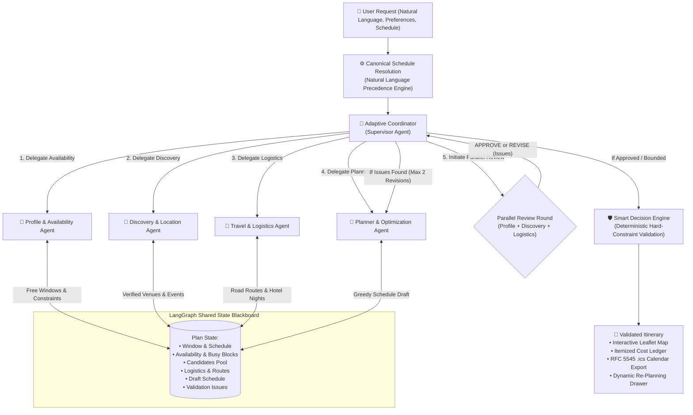
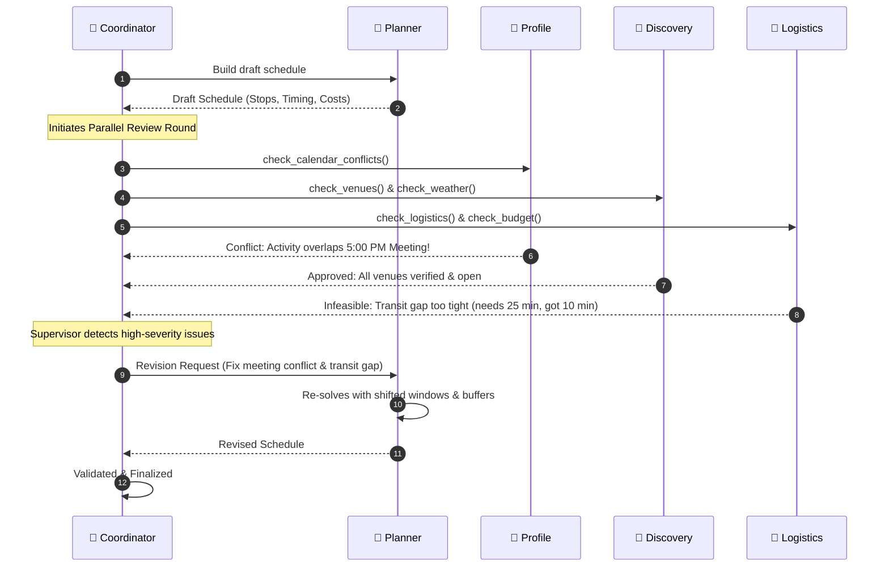
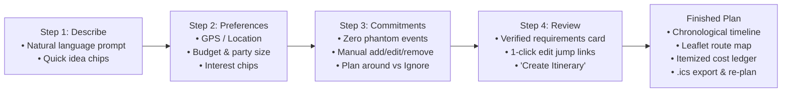

# LIFEPLAN AI: AUTONOMOUS MULTI-AGENT PERSONAL ACTIVITY AND TRIP PLANNER
## Project Presentation Slide Deck (20 Slides)

---

### **Project Team**
* **YASH PATEL** (PRN: `2307012235`)
* **ARSH ANSARI** (PRN: `23070122047`)
* **ALIRAZA SHAIKH** (PRN: `23070122023`)

**Department:** Computer Science & Information Technology  
**Institution:** Symbiosis Institute of Technology (SIT), Pune  
**Project Repository:** [github.com/yashpatelSIT/lifeplan-ai](https://github.com/yashpatelSIT/lifeplan-ai)  

---

## SLIDE 1: Title Slide

### **LIFEPLAN AI**
#### Autonomous Multi-Agent Personal Activity & Trip Planner
*Grounded Real-World Logistics, Constraint Enforcement & LangGraph Coordination*

* **Team Members:**
  - **Yash Patel** — `2307012235`
  - **Arsh Ansari** — `23070122047`
  - **Aliraza Shaikh** — `23070122023`
* **Faculty / Evaluation:** Semester VII Flexi / CA3 Capstone Project
* **Institution:** Symbiosis Institute of Technology (SIT), Pune

> **Speaker Notes:**  
> *"Good morning respected evaluators. Today we are presenting LifePlan AI, an autonomous multi-agent activity and vacation planning system built to solve the fundamental reliability and logistical failures of generic generative AI."*

---

## SLIDE 2: The Core Problem

### **Why Generic LLMs Fail at Real-World Planning**

* ❌ **Spatial Ignorance:** LLMs treat cities as words, proposing impossible commutes (e.g., crossing Mumbai in 10 minutes) or ignoring 150 km intercity highway travel.
* ❌ **Phantom Calendar Collisions:** Default models invent fictitious 9-to-5 routines or latch onto unconfirmed calendar feeds, blocking users when they are actually free.
* ❌ **Budget & Expense Amnesia:** Generic chatbots tally dinner costs but omit hotel accommodation, intercity tolls, local transit fares, and contingency funds.
* ❌ **Hallucinated POIs & Closed Venues:** Suggesting permanently closed attractions, educational colleges instead of tourist spots, or outdoor parks during torrential downpours.
* ❌ **Unchecked Multi-Day Routing:** Traditional tools route users back to their home city every night of a multi-day trip!

> **Speaker Notes:**  
> *"When you ask ChatGPT to plan a 3-day weekend trip from Pune to Mumbai under ₹20,000, it gives you a fluent story. But when you look at the reality, it leaves out hotel taxes, forgets highway travel time, sends you to places that closed years ago, and frequently routes you back to Pune every single night. LLMs are powerful reasoning engines, but they are not calculators, maps, or real-world fact sources."*

---

## SLIDE 3: Proposed Solution: LifePlan AI

### **Deterministic Grounding + Autonomous Multi-Agent Coordination**

* **Core Philosophy:** *Separate semantic reasoning from real-world truth.*
  - **LLMs** handle natural-language comprehension and user preference alignment.
  - **Deterministic Code & Real APIs** handle dates, coordinates, road distances, budgets, opening hours, and constraint validation.
* **Architecture:** Five specialized agents coordinated over a **LangGraph Shared Blackboard**.
* **Smart Decision Engine:** Deterministically enforces hard constraints (budget ceilings, hotel star classes, return arrival deadlines) independently of model outputs.
* **Zero Phantom Events:** Clean manual commitments engine — no ghost meetings.
* **Transparent Cost Ledger:** Full itemized accounting with an automatic 5% contingency buffer.

> **Speaker Notes:**  
> *"LifePlan AI bridges this gap. We do not ask an LLM to guess coordinates or estimate drive times. We built a system of five specialized autonomous agents orchestrated by LangGraph, where all physical facts are grounded in live mapping, routing, weather, and hotel APIs, validated by a deterministic Smart Decision Engine."*

---

## SLIDE 4: System Architecture Diagram

### **LangGraph Shared Blackboard Workflow**



> **Speaker Notes:**  
> *"Here is our core architecture. Everything revolves around an immutable LangGraph shared blackboard. The Adaptive Coordinator supervises the workflow: delegating availability to the Profile agent, venue search to Discovery, route timing to Logistics, and schedule assembly to Planner. Before presenting the plan, the Coordinator runs a parallel critique round where agents can demand revisions."*

---

## SLIDE 5: The 5 Autonomous Agents at a Glance

### **Specialization & Separation of Concerns**

| # | Agent Name | Core Responsibility | External Tools / Grounding |
|---|---|---|---|
| 1 | 🤖 **Adaptive Coordinator** | Orchestrator & supervisor. Parses canonical schedules, delegates tasks, manages review rounds, and handles revisions. | Blackboard state machine, `geocode()`, `validate_state()` |
| 2 | 🧠 **Profile & Routine** | Calculates true free-time windows. Manages manual commitments, checks public holidays, and eliminates ghost calendar blocks. | `calculate_availability()`, `public_holidays()`, `check_calendar_conflicts()` |
| 3 | 📍 **Discovery & Location** | Discovers open, rated venues, cafes, attractions, and live events. Purges irrelevant colleges, clinics, and residential complexes. | Geoapify Places, OpenStreetMap Overpass API, Tavily Search, Open-Meteo Weather |
| 4 | 🚗 **Travel & Logistics** | Calculates real-world road-network routes, transit modes (cab, drive, transit), estimates hotel nights, and converts FX currencies. | OSRM Routing Engine, SerpAPI Google Hotels/Flights, Frankfurter FX |
| 5 | 📅 **Planner & Optimization** | Schedule synthesis. Formulates activity sequences, fits stops into windows, balances pacing, and ensures intercity legs are preserved. | Schedule Solver (`build_schedule()`), Opening Hours Evaluator, Cost Accumulator |

> **Speaker Notes:**  
> *"Instead of one monolithic prompt, each agent is an expert in its own domain. Profile only cares about when you are free; Discovery only cares about verified places; Logistics only cares about realistic travel and hotels; Planner puts the puzzle together; and Coordinator oversees the entire lifecycle."*

---

## SLIDE 6: Agent 1 — Adaptive Coordinator (Supervisor)

### **The Brain of the Multi-Agent Lifecycle**

* **Supervisor Pattern:** Acts as the central director of the LangGraph state machine.
* **Intent Decomposition:** Categorizes requests into modes: `now`, `evening`, `day`, `weekend`, `domestic_trip`, or `international_trip`.
* **Natural-Language Precedence:** Ensures dates, return deadlines, and locations mentioned in prompt text take priority over default form pickers.
* **Review Chairperson:** Collects critique reports from the other agents, detects high-severity violations, and commands up to 2 targeted repair revisions.
* **Graceful Degradation:** Features automatic circuit breakers that detect API quota exhaustion and switch to deterministic fallbacks without crashing.

> **Speaker Notes:**  
> *"The Coordinator is our supervisor agent. It interprets user intent, ensures natural language overrides form defaults, assigns work to the appropriate agents in sequence, and chairs the review round to ensure zero unresolved high-severity bugs reach the user."*

---

## SLIDE 7: Agent 2 — Personal Profile & Availability Agent

### **Zero Phantom Events & Manual Commitment Precision**

* **The Problem Solved:** Eliminates the phantom calendar bug where 12 default meetings were automatically inserted into every plan.
* **Clean-Slate Availability:** A new plan starts with an **empty commitments list** (100% open window).
* **Manual Commitments Engine:**
  - Users can manually add, edit, and delete real commitments (e.g., *"Team Meeting 5:00 PM – 6:30 PM"*).
  - Explicit choice: **"Plan around these commitments"** vs **"Ignore commitments for this plan"** (vacation mode).
* **Commute Buffer Intelligence:** Automatically adds realistic commute buffers after meetings or work blocks.
* **Public Holiday Awareness:** Queries official national holidays (via Nager.Date) to unlock working hours on festival days.

> **Speaker Notes:**  
> *"Our Profile agent fixes one of the most frustrating AI bugs: phantom commitments. Unless the user explicitly enters a commitment, their calendar is treated as completely open. If they do enter a meeting, the agent splits their free windows around it and adds travel buffers automatically."*

---

## SLIDE 8: Agent 3 — Discovery & Location Agent

### **Verified Places & Noise Filtering**

* **No Hallucinated Venues:** Queries real-world POIs using **Geoapify Places API** and **OpenStreetMap Overpass API**.
* **Irrelevant Venue Purge:** Deterministically filters out institutional and non-leisure venues that OSM queries often mistakenly return:
  - 🏫 Colleges, universities, coaching academies, dormitories.
  - 🏥 Hospitals, clinics, diagnostic centers.
  - 🏢 Police stations, government offices, residential housing societies.
* **Live Event Discovery:** Uses **Tavily AI Search** to discover real-time comedy shows, gigs, exhibitions, and cultural performances.
* **Weather Exposure Protection:** Evaluates hourly forecasts via **Open-Meteo**. If precipitation > 60%, flags outdoor spots as infeasible and prioritizes covered indoor venues.

> **Speaker Notes:**  
> *"Discovery grounds every single stop in reality. It verifies latitude, longitude, and opening hours. Crucially, our Smart Decision Engine strips out junk results like colleges or medical clinics that often pollute search feeds, ensuring you only get genuine leisure and dining venues."*

---

## SLIDE 9: Agent 4 — Travel & Logistics Agent

### **Physical Grounding & Accurate Transit**

* **OSRM Road-Network Matrix:** Replaces straight-line approximations with actual driving, cab, and walking routes calculated over OpenStreetMap road networks.
* **Plausibility & Coordinate Swapping Correction:**
  - Detects inverted Indian subcontinent coordinates (`lat > 50, lon < 40`) and swaps them to valid format.
  - Enforces speed sanity limits: rejects walking speeds > 10 km/h or driving durations of 1,204 minutes for a 5 km hop.
* **Hotel Star-Class Verification:**
  - Queries **SerpAPI Google Hotels** for live nightly rates and verified star classes (3-star, 4-star, 5-star).
  - Rejects hotels falling below the user's requested star tier.
* **Intercity Connection Generation:** Automatically generates outbound and return journeys (cabs, trains, flights) with realistic highway driving times (~3.5 hrs for Pune–Mumbai).

> **Speaker Notes:**  
> *"Logistics handles the laws of physics. It calculates road-network travel times using OSRM, corrects swapped coordinates, and ensures driving speeds are realistic. For overnight trips, it verifies hotel star ratings and reserves hotel nights in the destination city."*

---

## SLIDE 10: Agent 5 — Planner & Optimization Agent

### **The Constraint-Satisfying Schedule Solver**

* **Greedy Window-Packing Algorithm:** Optimizes candidate stops against:
  - Interest suitability score (weight 0.35)
  - Distance & transit time minimization (weight 0.25)
  - Opening hours alignment (weight 0.20)
  - Cost vs budget ratio (weight 0.20)
* **Opening Hours & Meal Gaps:** Respects published operating hours (e.g., museums closing at 5:30 PM) and enforces mandatory gaps between major meals.
* **Strict Chronological Guarantee:** All scheduled stops are strictly ordered chronologically by start time. UI sorting applies exclusively to alternatives, never scrambling the daily timeline.
* **Pacing Configurations:** Supports `relaxed` (+20 min buffer), `balanced` (+10 min buffer), and `packed` (dense schedule).

> **Speaker Notes:**  
> *"The Planner is our mathematical solver. It fits the top candidates into your available free windows. It guarantees that stops are strictly chronological, never schedules a closed venue, enforces lunch and dinner spacing, and adapts to your chosen pace."*

---

## SLIDE 11: Multi-Agent Collaboration: The Review & Repair Loop

### **How the Agents Critique and Fix Each Other**



> **Speaker Notes:**  
> *"This sequence diagram shows the heart of our multi-agent architecture. The Planner generates a draft, but cannot finalize it alone. The Coordinator sends it to Profile, Discovery, and Logistics in parallel. If Profile spots a meeting overlap, or Logistics finds travel too tight, the Coordinator sends it back to Planner for targeted revision. Up to two revision rounds occur before presentation."*

---

## SLIDE 12: Smart Decision Engine: Deterministic Enforcement

### **Why Code Enforces Hard Constraints (Not Prompts)**

* **The Problem:** Prompts like *"Make sure budget is under ₹1,500"* are soft hints to an LLM; the model often ignores them.
* **The Solution:** The Smart Decision Engine evaluates structured draft itineraries using deterministic code:
  1. **Hard Budget Enforcement:** If total cost > user budget, immediately raises `OVER_BUDGET` (high severity). The plan status is marked **failed** rather than pretending success.
  2. **Mandatory Return Deadlines:** Calculates latest departure $T_{\text{depart}} = T_{\text{deadline}} - \Delta t_{\text{transit}}$. If any destination stop ends after $T_{\text{depart}}$, flags `RETURN_DEADLINE_VIOLATED`.
  3. **Duplicate Return Prevention:** Local return trips back to home city are suppressed if distance > 50 km, preventing Pune return hops on intermediate Mumbai nights.
  4. **Operating Hours Verification:** Checks interval overlaps; rejects venues closed during visit windows.

> **Speaker Notes:**  
> *"We do not rely on LLM prompts to enforce hard constraints. Our Smart Decision Engine uses deterministic code. If an itinerary costs ₹4,500 on a ₹1,500 budget, the system fails honestly with a clear explanation rather than hallucinating fake prices. If you need to be home by 8 PM, it mathematically ensures you depart on time."*

---

## SLIDE 13: External APIs & Technology Stack

### **Modern, High-Performance Tech Stack**

* **Backend Core:** Python 3.11+, **FastAPI**, **LangGraph**, **LangChain Core**, Pydantic v2.
* **LLM Engine:** **Groq** (`openai/gpt-oss-120b`, `openai/gpt-oss-20b`) for ultra-low latency; **Google Gemini** for fallback.
* **Geospatial & Mapping:**
  - **Geoapify Places API:** POI search, geocoding, venue details.
  - **OpenStreetMap Overpass API:** Open-data POI fallback.
  - **OSRM Engine:** Real-world driving, walking, and cab distance matrices.
* **Live Discovery & Weather:**
  - **Tavily Search API:** Real-time event extraction.
  - **SerpAPI:** Live Google Flights & Google Hotels pricing/star classes.
  - **Open-Meteo:** Hourly weather and precipitation probability.
  - **Frankfurter (ECB):** Real-time foreign exchange currency rates.
* **Frontend:** Vanilla JavaScript, Semantic HTML5, CSS3, **Leaflet.js** interactive maps.

> **Speaker Notes:**  
> *"Our stack combines FastAPI and LangGraph in Python, with ultra-fast LLM inference via Groq and Gemini. We integrate seven specialized external APIs for places, routing, events, hotels, weather, and currency. On the frontend, we use lightweight vanilla JavaScript with Leaflet maps for instant, zero-build rendering."*

---

## SLIDE 14: User Experience: Guided 4-Step Wizard

### **Consumer-Friendly Interface (No Developer Jargon)**



* **Step 1:** Natural-language intent with inspiration chips (*"Weekend getaway"*, *"Plan a date"*).
* **Step 2:** Origin location with 📍 **Current GPS** button, budget, and interest tags.
* **Step 3:** Clean commitments manager starting with **zero ghost events**.
* **Step 4:** Verified requirements preview confirming extracted dates, hotel star tiers, and deadlines.

> **Speaker Notes:**  
> *"We completely redesigned the UI from a cluttered form into a guided, 4-step wizard. Step 1 takes natural language; Step 2 sets preferences; Step 3 lets you manage commitments with zero clutter; Step 4 confirms extracted requirements; and Step 5 displays the visual itinerary."*

---

## SLIDE 15: Critical Innovations & Overhaul Highlights

### **Key Engineering Enhancements Delivered**

1. **Natural-Language Precedence:** Dates, return deadlines, and locations mentioned in text explicitly override form selectors.
2. **Coordinate Normalization:** Automatically detects and corrects swapped `(lon, lat)` coordinates on the Indian subcontinent.
3. **Plausibility Filters:** Eliminates absurd 1,204-minute city hops by enforcing physical speed boundaries.
4. **Duplicate Leg Elimination:** Enforces a 50 km geographic threshold, stopping multi-day vacations from routing back to origin every night.
5. **Itemized Cost Ledger:** Automatically breaks down Accommodation, Intercity Travel, Local Transit, Dining, Activities, and a **5% Contingency Buffer**.
6. **Timeline Chronological Lock:** Strictly sorts stops by arrival time, ensuring alternative sorting never scrambles the daily schedule.

> **Speaker Notes:**  
> *"This slide summarizes our major engineering breakthroughs. We eliminated the duplicate return legs, corrected inverted coordinates, enforced physical speed boundaries, locked timelines to strict chronological order, and added an itemized cost ledger with a built-in 5% contingency buffer."*

---

## SLIDE 16: Dynamic Re-Planning & Disruption Handling

### **Real-Time Runtime Adaptation**

* **The Problem:** Real-world plans get disrupted — sudden rain, traffic delays, or venues closing unexpectedly.
* **The Solution:** The **⚡ Quick Re-plan** drawer:
  - 🌧️ **"It's raining — shift outdoor stops to indoor alternatives":**  
    Discovery agent identifies outdoor parks or promenades and swaps them with verified indoor museums or covered cafes.
  - ⏰ **"Running 45 minutes late":**  
    Planner shifts subsequent arrival times forward, drops low-priority stops if windows close, and preserves dinner reservations.
  - 🚫 **"Venue closed / skipped":**  
    Removes the stop and pulls the next best alternative from the shortlisted candidate pool.
* **State Preservation:** Re-planning repairs the existing blackboard without losing budget or resetting the entire trip.

> **Speaker Notes:**  
> *"Life doesn't always go to plan. If it starts raining during your trip, you simply click 'It's raining' in our quick re-plan drawer. The multi-agent loop immediately swaps outdoor stops for indoor museums or cafes without blowing your budget or erasing your itinerary."*

---

## SLIDE 17: Testing, Verification & Regression Suite

### **100% Green Across All 93 Automated Tests**

* **Test Suite:** Built with `pytest` using synthetic and mock fixtures for high-speed offline verification.
* **Overhaul Regression Suite (`test_overhaul_regression.py`):** 20 targeted tests covering all critical overhaul criteria.

```
============================== 93 passed in 18.17s ==============================
```

| Key Verified Test Scenarios | Result |
|---|:---:|
| `test_01_empty_calendar_and_no_commitments` (Zero phantom events) | **PASSED** |
| `test_04_pune_to_mumbai_multi_day_vacation` (Outbound & return intercity legs) | **PASSED** |
| `test_05_mandatory_return_deadline` (8:00 PM return deadline enforcement) | **PASSED** |
| `test_06_three_star_minimum_hotel` (Rejection of < 3-star hotels) | **PASSED** |
| `test_07_strict_1500_budget` (₹4,500 plan strictly fails on ₹1,500 budget) | **PASSED** |
| `test_11_invalid_and_swapped_coordinates_handled` (Indian coord swapping) | **PASSED** |
| `test_13_duplicate_return_journeys_prevented` (>50km return suppression) | **PASSED** |
| `test_16_conflicting_dates_query_precedence` (Prompt overrides picker) | **PASSED** |
| `test_18_budget_calculation_with_all_ledger_categories` (5% contingency) | **PASSED** |
| `test_20_invalid_draft_must_not_be_marked_complete` (No false 'ok' status) | **PASSED** |

> **Speaker Notes:**  
> *"We do not just claim this works — we proved it with a comprehensive automated test suite. All 93 tests pass in under 19 seconds. Every single constraint — from coordinate swapping to budget ceilings and return deadlines — is verified by unit and end-to-end integration tests."*

---

## SLIDE 18: Live Demo Showcase Walkthrough

### **Flagship Test Scenario: Pune to Mumbai 3-Day Vacation**

* **User Prompt:**  
  > *"Plan a 3-day trip from Pune to Mumbai from Friday 9:00 AM to Sunday evening. We need at least a 3-star hotel, want to explore Marine Drive, heritage sites, and great seafood. Budget is ₹22,000 for 2 people. I must be back in Pune by 8:00 PM on Sunday."*
* **Live System Outputs Shown:**
  1. **Natural Language Precedence:** Automatically resolved Friday–Sunday dates and Pune–Mumbai origin/destination.
  2. **Intercity Leg:** Outbound Pune → Mumbai cab (~3.5 hrs, ~150 km) on Friday morning.
  3. **Verified Hotel:** Taj Lands End / Marine Plaza (3+ star rating verified, 2 nights).
  4. **Strict Deadline Departure:** Sunday afternoon departure from Mumbai at 4:15 PM to reach Pune before 8:00 PM.
  5. **Itemized Cost Ledger:** Accommodation + Transit + Food + Activities + 5% Contingency = ₹19,650 (Within Budget, ₹2,350 remaining).
  6. **Exports:** RFC 5545 `.ics` file download and interactive Leaflet route map.

> **Speaker Notes:**  
> *"In our live demo, we showcase this 3-day vacation prompt. Notice how the system captures all constraints: it schedules the outbound highway leg, books a verified 3-star hotel, clusters Mumbai sightseeing locally, departs in time to meet the 8 PM Pune deadline, and transparently itemizes the entire ₹22,000 budget."*

---

## SLIDE 19: Conclusion & Future Scope

### **Bridging Generative AI and Grounded Operations**

* **Summary of Contributions:**
  - Designed and deployed an autonomous 5-agent system using LangGraph.
  - Eliminated phantom calendar events and replaced them with manual commitments.
  - Built a deterministic Smart Decision Engine that enforces budgets, ratings, and physical transit rules.
  - Achieved 100% test pass rate across 93 automated regression tests.
* **Future Work:**
  - 🎟️ **Direct Booking APIs:** Transition from informational links to live reservation booking (IRCTC, OpenTable, Booking.com).
  - 👥 **Collaborative Group Planning:** Shared multi-user planning rooms with live voting on candidate venues.
  - 🚆 **Public Transit Micro-Routing:** Integration of real-time GTFS feeds for metro and suburban rail systems.

> **Speaker Notes:**  
> *"In conclusion, LifePlan AI demonstrates how combining generative AI with deterministic multi-agent graphs produces reliable, production-ready software. For future work, we plan to integrate direct booking APIs and live collaborative group planning."*

---

## SLIDE 20: Thank You & Q&A

### **LIFEPLAN AI**
#### Autonomous Multi-Agent Personal Activity & Trip Planner

* **Team Members:**
  - **Yash Patel** (`2307012235`)
  - **Arsh Ansari** (`23070122047`)
  - **Aliraza Shaikh** (`23070122023`)
* **Project Repository:** [github.com/yashpatelSIT/lifeplan-ai](https://github.com/yashpatelSIT/lifeplan-ai)
* **Live Deployment:** [http://localhost:8000](http://localhost:8000)

---
### **Questions & Answers**
*We welcome your questions and feedback.*

> **Speaker Notes:**  
> *"Thank you for your time and attention. We are now happy to answer any questions about our architecture, multi-agent coordination, or live demo."*
