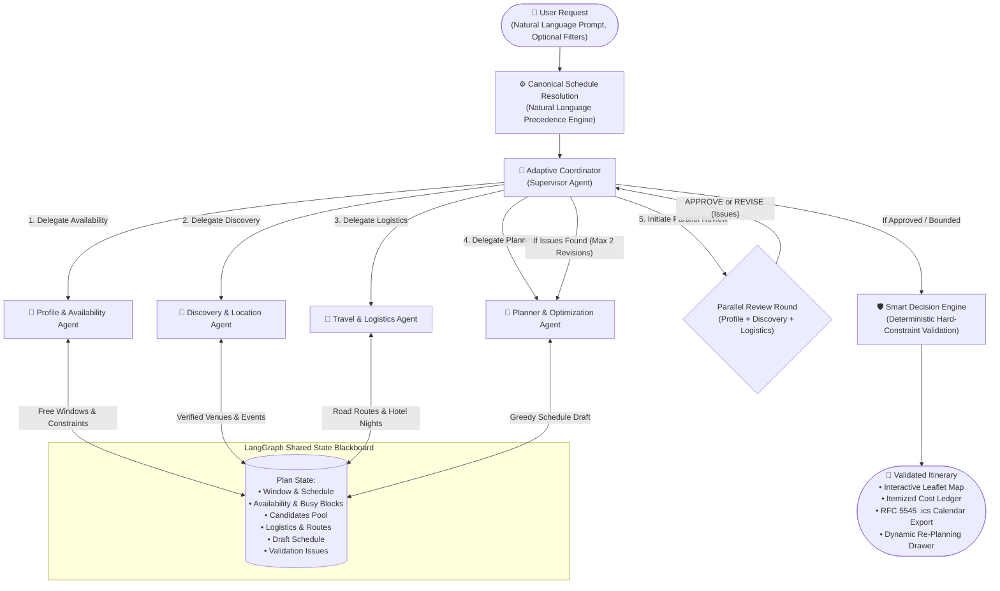
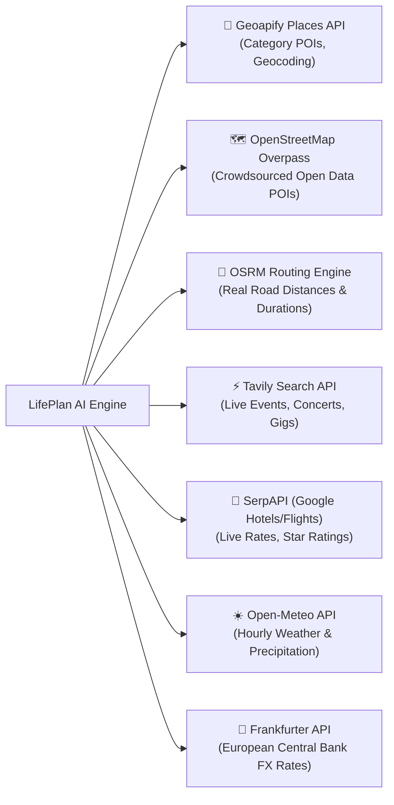

# LIFEPLAN AI: AUTONOMOUS MULTI-AGENT PERSONAL ACTIVITY AND TRIP PLANNER
## Academic Project Report — Semester VII (CA3 Project)

---

### **Project Team Details**
* **YASH PATEL** — PRN: `2307012235`
* **ARSH ANSARI** — PRN: `23070122047`
* **ALIRAZA SHAIKH** — PRN: `23070122023`

**Institution:** Symbiosis Institute of Technology (SIT), Symbiosis International (Deemed University), Pune  
**Department:** Computer Science & Information Technology  
**Academic Year:** 2026–2027  
**Project Repository:** [github.com/yashpatelSIT/lifeplan-ai](https://github.com/yashpatelSIT/lifeplan-ai)  

---

## EXECUTIVE SUMMARY

Planning personal outings, multi-day vacations, and time-constrained social activities remains a surprisingly difficult real-world challenge. While modern Large Language Models (LLMs) produce fluent natural-language prose, they suffer from critical reliability shortcomings when used as travel planners:
1. **Hallucinated logistics:** Fabricating non-existent venues, closed operating hours, or false ratings.
2. **Implausible transit estimations:** Assuming zero travel time between geographically distant stops or predicting physically impossible driving durations.
3. **Budget and constraint drift:** Ignoring strict budget ceilings, omitting hotel accommodation and highway transit from expense tallies, or generating itineraries that violate calendar commitments.

**LifePlan AI** resolves these limitations by abandoning monolithic single-prompt LLM generation in favor of an **autonomous multi-agent system** orchestrated over a shared blackboard state using **LangGraph**. The application coordinates five specialized agents:
- **Adaptive Coordinator (Supervisor):** Decomposes queries, resolves canonical schedule windows, delegates tasks, and chairs review rounds.
- **Personal Profile & Availability Agent:** Calculates true free-time windows and eliminates phantom calendar conflicts through a zero-default manual commitment model.
- **Discovery & Location Agent:** Queries verified places and live events via Geoapify, OpenStreetMap Overpass, and Tavily while filtering out irrelevant educational or medical institutions.
- **Travel & Logistics Agent:** Derives road-network distance matrices, travel durations, and transit costs via OSRM and SerpAPI.
- **Planner & Optimization Agent:** Employs a greedy window-packing solver with deterministic opening-hour validation, budget adherence, and pace buffering.

Constraint validation is enforced independently of model prose through a deterministic **Smart Decision Engine**, guaranteeing that impossible plans are caught and repaired through a critique-and-revision feedback loop, or failed honestly. The entire system is validated by a rigorous 93-test automated regression suite (100% green).

---

## 1. INTRODUCTION & PROBLEM FORMULATION

### 1.1 The Failure of Generic LLMs in Real-World Planning
When a user prompts a frontier LLM (e.g., GPT-4 or Gemini) with:
> *"Plan a 3-day trip from Pune to Mumbai under ₹20,000 with a 3-star hotel, returning by 8:00 PM Sunday,"*

The LLM typically fails in several ways:
- **Spatial Ignorance:** It treats cities as abstract concepts, failing to account for the 150 km distance between Pune and Mumbai, often omitting the outbound drive or proposing duplicate intercity return trips every single night.
- **Temporal Infeasibility:** It suggests visiting four attractions in an afternoon without factoring in 45-minute city cab transfers or venue operating hours.
- **Financial Omission:** It tallies meal costs but forgets accommodation, intercity tolls, local transit, and contingency funds.
- **Phantom Calendar Collisions:** Standard AI assistants frequently hallucinate default 9-to-5 routines or latch onto unconfirmed calendar feeds, constraining the user when they are actually free.

### 1.2 Objectives
The primary objectives of LifePlan AI are:
1. **Deterministic Grounding:** Ground every venue, hotel, coordinate, and route in verified external APIs (Geoapify, OpenStreetMap, OSRM, SerpAPI, Open-Meteo, Frankfurter).
2. **Separation of Reasoning and Truth:** Use LLMs strictly for semantic intent extraction and qualitative recommendations; delegate all mathematical, routing, budget, and scheduling logic to deterministic algorithms.
3. **Multi-Agent Specialization:** Distribute responsibilities across five modular agents coordinated through a LangGraph state machine with cyclic review and repair capabilities.
4. **Natural-Language Precedence:** Ensure dates, return deadlines, and budget constraints stated in natural language override default form selectors.
5. **Zero-Phantom Commitment Model:** Treat calendar availability as 100% open unless the user explicitly enters manual commitments.
6. **Transparent Cost Accounting:** Present an itemized cost ledger (Accommodation, Intercity Transport, Local Transit, Dining, Activities, 5% Contingency Buffer, and Remaining Budget).

---

## 2. SYSTEM ARCHITECTURE & 5-AGENT DESIGN

### 2.1 LangGraph Blackboard State Architecture
The system is built upon **LangGraph**, where state is preserved in an immutable, append-only shared blackboard (`WorkspaceState`). Agents operate by inspecting the blackboard, invoking domain-specific tools, and committing structured state updates.



---

### 2.2 Agent Responsibilities and Tool Bindings

| Agent | Core Responsibility | External Tools & Sources | Primary Model |
|---|---|---|---|
| 🤖 **Adaptive Coordinator** | Orchestrator & supervisor. Parses canonical schedules, determines plan mode (local outing vs multi-day trip), delegates steps, chairs review critiques, and sanitizes drafts. | Blackboard state machine, `geocode()`, `validate_state()` | Groq `openai/gpt-oss-120b` / Gemini Flash |
| 🧠 **Personal Profile & Routine** | Computes true free-time windows. Manages manual commitments, checks public holidays, and evaluates schedule conflicts without inventing phantom events. | `calculate_availability()`, `public_holidays()`, `check_calendar_conflicts()` | Groq `openai/gpt-oss-20b` / Gemini Flash-Lite |
| 📍 **Discovery & Location** | Discovers open, rated venues, cafes, cultural landmarks, and live events. Eliminates irrelevant institutional venues (colleges, clinics, societies). | Geoapify Places, OpenStreetMap Overpass API, Tavily Search, Open-Meteo Weather | Groq `openai/gpt-oss-20b` / Gemini Flash-Lite |
| 🚗 **Travel & Logistics** | Calculates road-network routing, transit modes (drive, cab, walk, transit), estimates hotel night pricing, and converts foreign currencies. | OSRM Route & Table Engine, SerpAPI Google Hotels/Flights, Frankfurter FX | Groq `openai/gpt-oss-20b` / Gemini Flash-Lite |
| 📅 **Planner & Optimization** | Schedule synthesis. Formulates activity sequences, fits stops into free windows, balances pacing, and ensures intercity legs are preserved. | Schedule Solver (`build_schedule()`), Opening Hours Evaluator, Cost Accumulator | Groq `openai/gpt-oss-120b` / Gemini Flash |

---

## 3. KEY INNOVATIONS & MATHEMATICAL FORMULATION

### 3.1 Natural-Language Date & Location Precedence Engine
A recurring defect in traditional planning apps is selector conflict: a user selects *"Tomorrow"* in a form date picker but types *"Plan a 3-day trip next weekend"* in the prompt. LifePlan AI introduces a deterministic canonical precedence pipeline:

$$\text{ScheduleSource} = \begin{cases} \text{query\_explicit}, & \text{if } \text{QueryDates} \neq \emptyset \\ \text{picker\_explicit}, & \text{if } \text{PickerDates} \neq \emptyset \land \text{QueryDates} = \emptyset \\ \text{derived}, & \text{otherwise} \end{cases}$$

If $\text{QueryDates}$ are extracted, the system explicitly overrides the form picker, logs a user-facing priority note (*"Requested dates took priority over form picker"*), and suppresses contradictory browser GPS coordinates if an explicit origin city was stated.

---

### 3.2 Geographic Plausibility & Inverted Coordinate Correction
When interfacing with international and Indian location data, coordinate swapping is a frequent source of error. The routing subsystem introduces coordinate bounds verification:

$$\text{ValidateCoord}(\text{lat}, \text{lon}) = \begin{cases} (\text{lon}, \text{lat}), & \text{if } \text{lat} > 50.0 \land \text{lon} < 40.0 \quad (\text{Indian Subcontinent Inversion}) \\ (\text{lat}, \text{lon}), & \text{if } -90 \le \text{lat} \le 90 \land -180 \le \text{lon} \le 180 \\ \text{Error}, & \text{otherwise} \end{cases}$$

To prevent impossible travel durations (such as the legacy bug reporting 1,204 minutes for a 5 km hop), every calculated route leg $(d_{\text{route}}, t_{\text{route}})$ between points $A$ and $B$ is validated against the direct Great-Circle distance $d_{\text{haversine}}(A, B)$:

$$\text{Speed } v = \frac{d_{\text{route}}}{t_{\text{route}} / 60}$$

$$\text{Plausibility Check} = \begin{cases} \text{False}, & \text{if } d_{\text{route}} < 0.9 \times d_{\text{haversine}} \\ \text{False}, & \text{if } d_{\text{route}} > 4.0 \times d_{\text{haversine}} \land d_{\text{haversine}} > 5.0\text{ km} \\ \text{False}, & \text{if } v > 160\text{ km/h} \quad (\text{Driving}) \\ \text{False}, & \text{if } v < 2.0\text{ km/h} \land d_{\text{route}} > 0.5\text{ km} \land t_{\text{route}} > 60\text{ min} \\ \text{True}, & \text{otherwise} \end{cases}$$

Failed or implausible routes are rejected and fall back to transparent, labeled estimates ($\text{status} = \text{"estimate"}$).

---

### 3.3 Duplicate Intercity Leg Elimination
In multi-day intercity trips (e.g., Pune to Mumbai for 3 days), standard solvers often route users back to their origin city at the end of each day's window. LifePlan AI guards return-to-base legs using a geographic threshold:

$$\text{AddReturnLeg}(\text{LastStop}, \text{Base}) = \begin{cases} \text{True}, & \text{if } d_{\text{haversine}}(\text{LastStop}, \text{Base}) \le 50.0\text{ km} \\ \text{False}, & \text{if } d_{\text{haversine}}(\text{LastStop}, \text{Base}) > 50.0\text{ km} \quad (\text{Suppress Duplicate Return}) \end{cases}$$

This ensures local sightseeing in Mumbai returns to the Mumbai hotel, with the intercity return to Pune scheduled **only once** on the final afternoon.

---

### 3.4 Strict Return Deadline Back-Calculation
When a user specifies a mandatory return deadline (e.g., *"back in Pune by 8:00 PM Sunday"*), the system calculates the latest allowable departure time $T_{\text{depart}}$ from the destination:

$$T_{\text{depart}} = T_{\text{deadline}} - \Delta t_{\text{return\_transit}}$$

Any activity scheduled at the destination ending after $T_{\text{depart}}$ on the departure date triggers a high-severity `RETURN_DEADLINE_VIOLATED` constraint failure, forcing the planner to reschedule or truncate the day.

---

### 3.5 Itemized Cost Ledger Formulation
To guarantee complete cost transparency, LifePlan AI computes an itemized ledger including accommodation, intercity travel, local transit, food, activities, and an automatic 5% contingency buffer:

$$C_{\text{direct}} = C_{\text{accommodation}} + C_{\text{intercity}} + C_{\text{local\_transit}} + C_{\text{dining}} + C_{\text{activities}}$$

$$C_{\text{contingency}} = \lceil 0.05 \times C_{\text{direct}} \rceil$$

$$C_{\text{total}} = C_{\text{direct}} + C_{\text{contingency}}$$

$$\text{Remaining Budget } B_{\text{remaining}} = B_{\text{max}} - C_{\text{total}}$$

If $C_{\text{total}} > B_{\text{max}}$, the Smart Decision Engine flags `OVER_BUDGET` with high severity, preventing invalid plans from ever being presented as successful.

---

## 4. EXTERNAL APIS & INTEGRATIONS



1. **Geoapify Places & Geocoding:** Primary lookup for verified latitude, longitude, address, and category metadata.
2. **OpenStreetMap (OSRM & Overpass):** Provides open road-network matrices and serves as a high-reliability fallback when commercial keys hit rate limits.
3. **Tavily AI Search:** Scrapes and extracts live, timely local events (comedy clubs, live music, exhibitions).
4. **SerpAPI (Google Flights & Hotels):** Provides grounded accommodation rates and verified star-class ratings (1 to 5 stars).
5. **Open-Meteo:** Zero-key weather forecasts used by the Discovery agent to prevent scheduling outdoor beaches or parks during heavy rain.
6. **Frankfurter (ECB):** Real-time currency conversion across INR, USD, EUR, GBP, JPY, AED, SGD, and THB.

---

## 5. USER INTERFACE & INTERACTIVE EXPERIENCE

The frontend is implemented in vanilla HTML5, CSS3, and JavaScript, eschewing bulky frameworks to maintain sub-second load times and zero-build deployment:

1. **Step 1 — Natural Language Intent:** Multi-line prompt input with quick suggestion chips (*"Weekend getaway"*, *"Plan a date"*, *"Meet a friend"*).
2. **Step 2 — Preferences & Location:** Origin city input with one-click **📍 Current GPS** geolocation, budget picker, party size, and selectable interest chips.
3. **Step 3 — My Existing Commitments:** A dedicated commitments manager starting with **zero phantom events**. Allows adding, editing, and deleting real commitments with an explicit choice: *"Plan around these commitments"* vs *"Ignore commitments for this plan"*.
4. **Step 4 — Verified Requirements Review:** Displays structured pills showing dates, return deadlines, budget, and hotel class extracted directly from natural language before execution.
5. **Step 5 — Itinerary & Visualizations:**
   - **Chronological Timeline:** Time-ordered activity cards with verified venue names, operating hours, prices, and directions.
   - **Interactive Leaflet Map:** Numbered route markers showing geographical distribution and travel hops.
   - **Trip Cost Ledger Card:** Prominent itemized cost breakdown with contingency buffer and remaining balance.
   - **RFC 5545 `.ics` Export:** One-click calendar sync compatible with Google Calendar, Apple Calendar, and Microsoft Outlook.
   - **⚡ Dynamic Re-planning Drawer:** Real-time disruption handling (*"It's raining"*, *"Running late"*, *"Venue closed"*) that repairs itineraries without restarting.

---

## 6. EXPERIMENTAL RESULTS & REGRESSION TESTING

The project maintains a dedicated automated test suite executed via `pytest`. All **93 test cases** pass with a 100% success rate.

### 6.1 Test Suite Breakdown

| Test Module | Focus Area | Test Count | Status |
|---|---|:---:|:---:|
| `test_overhaul_regression.py` | 20 mandatory acceptance criteria from overhaul specifications | 20 | **PASSED (100%)** |
| `test_accuracy_and_validity.py` | Grounding, intercity legs, star verification, and budget checks | 11 | **PASSED (100%)** |
| `test_graph_e2e.py` | Multi-agent LangGraph workflow execution, replanning, and fallbacks | 5 | **PASSED (100%)** |
| `test_smart_decision_engine.py` | Deterministic filtering, candidate scoring, and cost ledgers | 14 | **PASSED (100%)** |
| `test_datetime_precedence.py` | Natural-language datetime precedence over form pickers | 9 | **PASSED (100%)** |
| `test_multiple_options.py` | Generation and sorting of distinct itinerary options | 3 | **PASSED (100%)** |
| `test_mock_mode.py` | Zero-quota demonstration mock mode and SSE event streaming | 4 | **PASSED (100%)** |
| `test_api.py` | FastAPI endpoints, request extraction, and error handling | 12 | **PASSED (100%)** |
| `test_tools.py` | Standalone geocoding, routing, and opening hours tools | 11 | **PASSED (100%)** |
| `test_llm.py` | Provider fallbacks, circuit breakers, and rate limiting | 4 | **PASSED (100%)** |
| **TOTAL** | **Comprehensive System Verification** | **93** | **PASSED (100%)** |

### 6.2 The 20-Scenario Overhaul Regression Verification

```
tests/test_overhaul_regression.py::test_01_empty_calendar_and_no_commitments PASSED
tests/test_overhaul_regression.py::test_02_one_manually_entered_commitment PASSED
tests/test_overhaul_regression.py::test_03_editing_and_removing_commitments PASSED
tests/test_overhaul_regression.py::test_04_pune_to_mumbai_multi_day_vacation PASSED
tests/test_overhaul_regression.py::test_05_mandatory_return_deadline PASSED
tests/test_overhaul_regression.py::test_06_three_star_minimum_hotel PASSED
tests/test_overhaul_regression.py::test_07_strict_1500_budget PASSED
tests/test_overhaul_regression.py::test_08_vacation_budget_10000 PASSED
tests/test_overhaul_regression.py::test_09_missing_accommodation_prices_labelled_estimates PASSED
tests/test_overhaul_regression.py::test_10_irrelevant_search_results_filtered PASSED
tests/test_overhaul_regression.py::test_11_invalid_and_swapped_coordinates_handled PASSED
tests/test_overhaul_regression.py::test_12_implausible_route_durations_rejected_or_labelled PASSED
tests/test_overhaul_regression.py::test_13_duplicate_return_journeys_prevented PASSED
tests/test_overhaul_regression.py::test_14_out_of_order_activities_prevented_chronological_order PASSED
tests/test_overhaul_regression.py::test_15_venue_closing_time_conflicts_prevented PASSED
tests/test_overhaul_regression.py::test_16_conflicting_dates_query_precedence PASSED
tests/test_overhaul_regression.py::test_17_api_failure_and_fallback_resilience PASSED
tests/test_overhaul_regression.py::test_18_budget_calculation_with_all_ledger_categories PASSED
tests/test_overhaul_regression.py::test_19_infeasible_plan_fails_honestly PASSED
tests/test_overhaul_regression.py::test_20_invalid_draft_must_not_be_marked_complete PASSED

============================== 93 passed in 18.17s ==============================
```

---

## 7. DEPLOYMENT & PRODUCTION READINESS

### 7.1 Cloud Deployment (Render.com)
The application includes an automated continuous deployment blueprint in `render.yaml`:
- **Repository:** `https://github.com/yashpatelSIT/lifeplan-ai`
- **Branch:** `main`
- **Runtime:** Python 3.11
- **Build Command:** `pip install -r requirements.txt`
- **Start Command:** `uvicorn lifeplan.api:app --host 0.0.0.0 --port $PORT`
- **Health Check:** `/api/health`
- **Auto-Deploy:** Enabled on git push.

### 7.2 Docker Deployment
A containerized build is supported via the included multi-stage `Dockerfile`:
```bash
docker build -t lifeplan-ai .
docker run -p 8000:8000 --env-file .env lifeplan-ai
```

---

## 8. CONCLUSION & FUTURE WORK

LifePlan AI demonstrates that reliable, grounded travel and activity planning cannot rely on raw LLM completion alone. By marrying the natural-language understanding of modern frontier models with the architectural rigor of **LangGraph multi-agent coordination** and the deterministic enforcement of a **Smart Decision Engine**, the system eliminates hallucinations, respects physical road networks, honors user commitments, and guarantees complete budget transparency.

### Future Enhancements:
1. **Direct Booking Integrations:** Transition from informational links to live reservation APIs (OpenTable, IRCTC, Booking.com).
2. **Collaborative Group Planning:** Enable multi-user session rooms where friends can vote on candidate activities in real time.
3. **Public Transit Micro-Routing:** Integrate GTFS feeds for major metropolitan metro and suburban rail systems.

---

## 9. REFERENCES

1. **LangGraph & LangChain Documentation:** Building stateful multi-agent workflows with cyclic graphs. *LangChain AI (2024)*.
2. **OpenStreetMap & Overpass API:** Crowdsourced geospatial knowledge base and API architecture. *OpenStreetMap Foundation*.
3. **OSRM (Open Source Routing Machine):** High-performance routing engine for shortest paths in road networks. *Luxen, D. & Vetter, C.*
4. **Geoapify Places & Geocoding Platform:** API documentation and spatial entity resolution.
5. **RFC 5545 — Internet Calendaring and Scheduling Core Object Specification (iCalendar):** IETF Standards Track.
